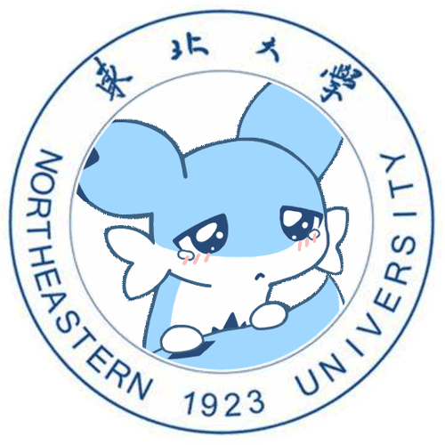
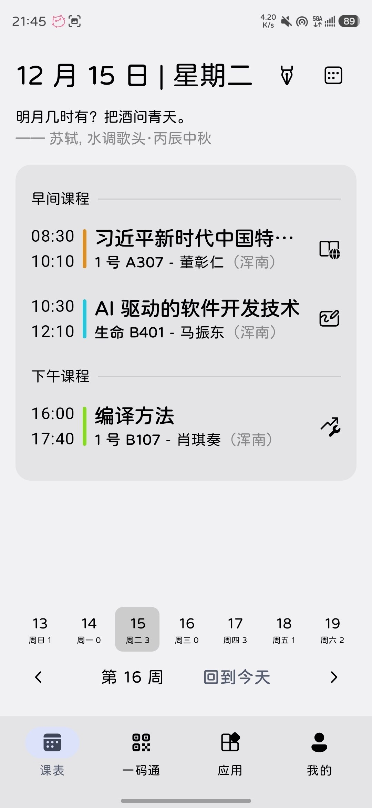
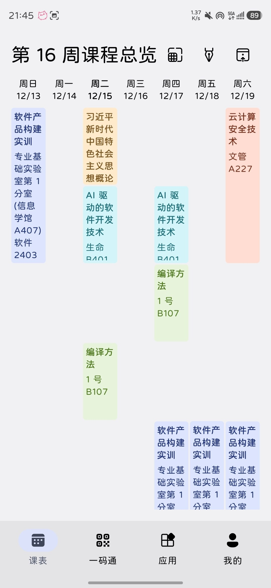
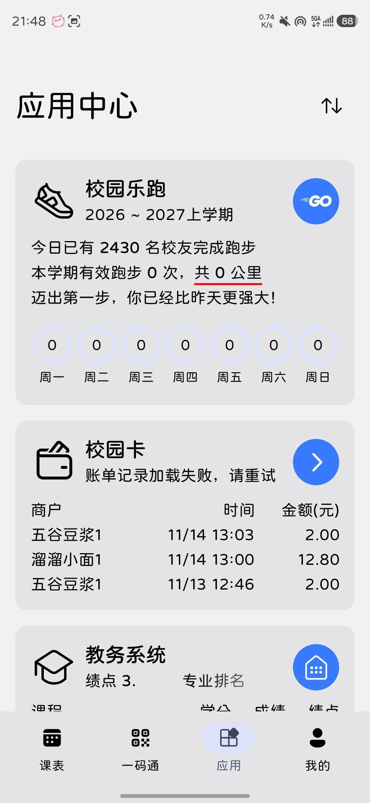
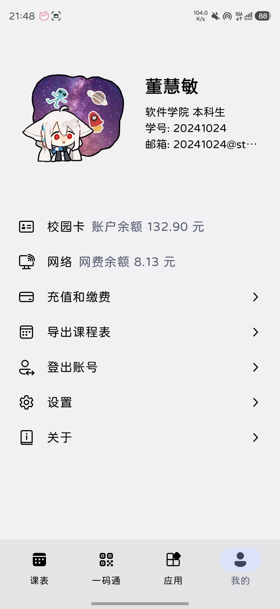

  
   

<h1 align="center">NEU Pass</h1>

📳 **NEU Pass** 是一款使用 Kotlin Multiplatform 技术开发的校园生活工具软件，旨在作为东北大学「智慧东大」App 的一个更轻巧快速的替代品。

### 功能特性

- 一码通：秒开秒亮码、支持缓存

- 课程表：支持校内 / 校外导入更新课表和自定义课程

- 校园乐跑：与 App 本体都支持深色模式，续航更优

- 充值缴费、教务成绩查询、消费记录查询等

... 更多功能，期待您的使用。

如果您对其它功能有需求，或发现了软件存在的不足，欢迎提交 issue 或 pull request。

    
    
    
    
    

 

> 本工具以个人学习客户端和方便日常生活为目的而开发，仅供**学习交流使用**。 
> 如有侵犯到您版权的材料，请随时 [联系我](mailto:me@chyk.ink) 删除。

本仓库是NEU Pass的开源代码快照，已移除协议加解密实现、固定密钥及接口文档。Crypto仅保留接口声明，当前分支不能直接构建；登录、校园乐跑和WebVPN相关功能需要自行补齐实现。详见[开发指南](docs/开发指南.md)。

### 许可证

本仓库中的NEU Pass原创代码采用GNU Affero General Public License v3.0（AGPL-3.0-only），完整条款见[LICENSE](LICENSE)。

第三方代码、字体、图标和其他素材遵循各自的许可证或授权，不因本仓库的主许可证而改变。第三方许可正文随应用资源保存，来源及尚待核实的素材见[第三方许可清单维护](docs/第三方许可清单维护.md)。

### 技术栈和 AI 相关

基础技术：Kotlin Multiplatform / Compose Multiplatform 
持久化：MMKV 
二维码生成：Zxing 
网页浏览：腾讯 X5 SDK 
界面设计：Material Design 3 + Fluent UI System Icons

本项目超过半数代码和总体架构**由人工维护**，允许采用 AI 编写代码，但必须披露使用的 AI 模型 / 工具及确保提交的代码可以解释。

开发指南见 [文档](./docs/)。

### 平台支持

目前仅支持 Android。 
实验性支持 Windows / Linux 用于开发。iOS 支持将在日后添加。

© 2024 - 2026 斩风千雪 ❄️ 
© 1923 - 2026 东北大学
